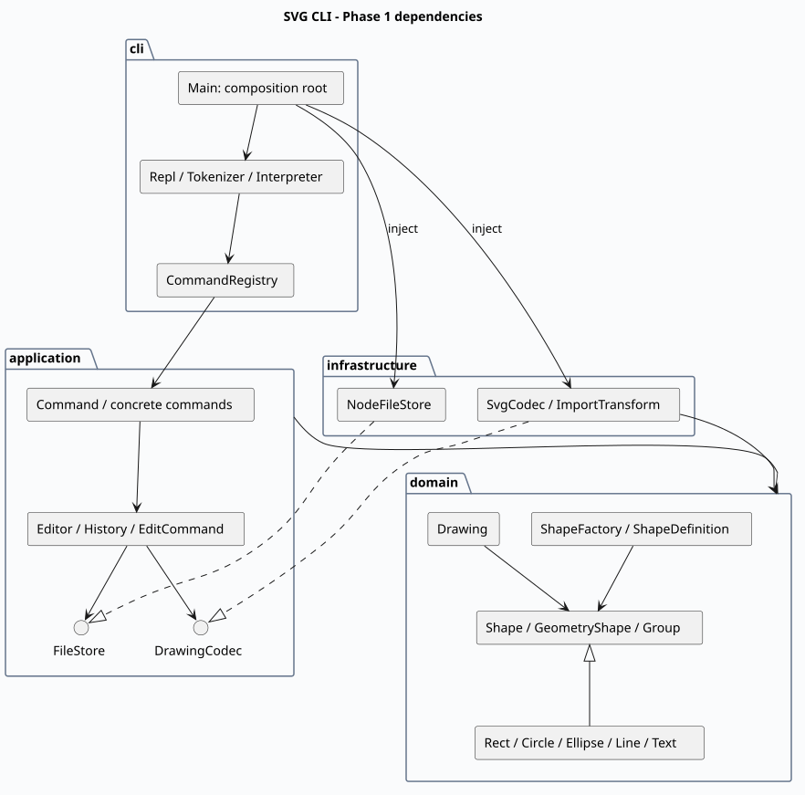

# SVG 编辑器 CLI

TypeScript 面向对象的 Lab1 Phase 1 实现：六种图形、19 条命令、Command / Composite、事务式 undo/redo、SVG 保存与读回。

**仓库地址**：[jackiedu1184800934-dotcom/svg-editor-cli](https://github.com/jackiedu1184800934-dotcom/svg-editor-cli)

**完整提交文档**：[doc/README.md](doc/README.md)，包含架构方案、PlantUML 图、过程记录、一致性自查与质量保证。

## 快速开始

需要 Node.js 22+ 和 npm。

```sh
npm ci
npm test
npm run cli
```

```text
svg> init
svg> create g scene
svg> create rect r1 20 30 120 60 blue in scene
svg> move scene 10 0
svg> undo
svg> tree
svg> save demo.svg
```

浏览器打开 demo.svg 预览，Ctrl+D 退出。脚本回放：

```sh
npm run build
node dist/cli/Main.js < examples/flowchart.commands
```

最终标记：final。32 项测试通过，详见[验证记录](doc/test-report.txt)与[GitHub Actions](https://github.com/jackiedu1184800934-dotcom/svg-editor-cli/actions)。


