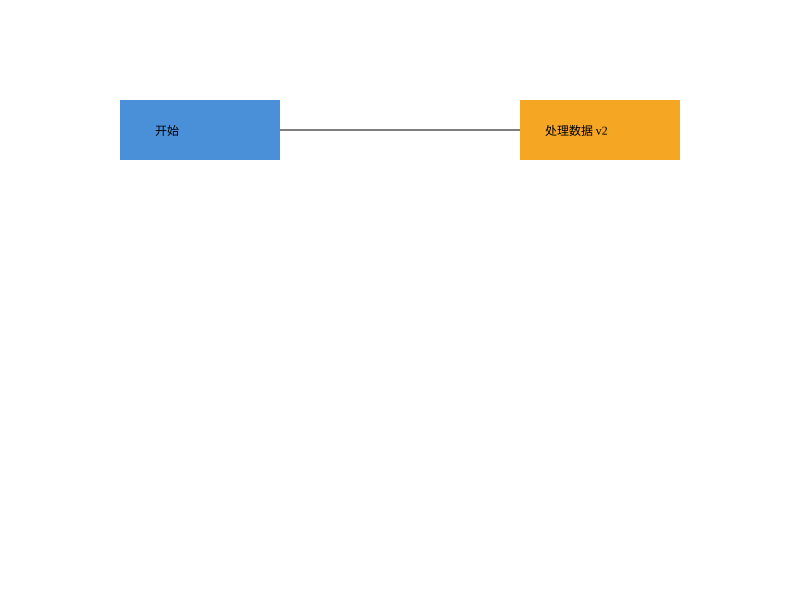
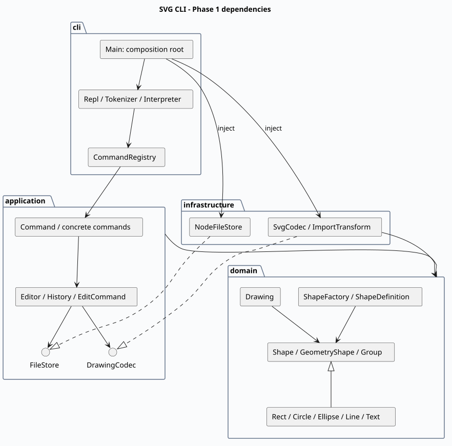

# Lab1 Phase 1：SVG 编辑器（CLI）

- **Git 仓库**：[jackiedu1184800934-dotcom/svg-editor-cli](https://github.com/jackiedu1184800934-dotcom/svg-editor-cli)
- **提交版本**：[final 标签](https://github.com/jackiedu1184800934-dotcom/svg-editor-cli/tree/final)
- 开发日期：2026-10-31（Asia/Shanghai）。
- 协作方式：用户提供要求并确认公开仓库；Codex 完成架构、实现、自查和测试。本文中的代码问题发现与修正由 AI 自查产生，不冒充用户已经进行的代码审阅。
- 阶段范围：19 条命令和 rect / circle / ellipse / line / text / g 六种图形。按任务要求，box 报 unknown shape type；不实现插件加载和 GUI。

## 运行与复现

安装 Node.js 22 或更高版本（附带 npm）后运行：

```sh
git clone https://github.com/jackiedu1184800934-dotcom/svg-editor-cli.git
cd svg-editor-cli
git checkout final
npm ci
npm test
npm run cli
```

交互模式显示 `svg>`；Ctrl+D 结束。输入 `help` 查看所有命令和各类型创建参数。批处理模式逐行执行、遇错继续、不输出提示符：

```sh
npm run build
node dist/cli/Main.js < examples/flowchart.commands
node dist/cli/Main.js < examples/session.commands
```

请在仓库根目录回放：相对路径以进程工作目录为准。第一段生成 flowchart.svg；第二段生成 demo.svg，并有意包含非法分组、保存后 undo 两条错误命令。用浏览器打开 SVG 即可预览。以下为程序实际生成的示例：



| 类别 | 命令 |
|---|---|
| 文档 | `init [w] [h]`、`read <file.svg>`、`save [file.svg]`、`canvas [w] [h]` |
| 创建 | `create <type> <id> [params...] [in <containerId>]` |
| 编辑 | `delete <id>`、`move <id> <dx> <dy>`、`scale <id> <factor>`、`set <id> <attr> <value>` |
| 结构 | `group <newGid> <id1> <id2>...`、`ungroup <gid>`、`addto <gid> <id>` |
| 层次 | `front <id>`、`back <id>` |
| 显示 | `tree [id]`、`show <id>`、`help` |
| 历史 | `undo`、`redo` |

双引号支持带空格及空字符串参数，双引号内可转义引号、反斜线。仅去除前导空白后以 # 开头的整行是注释；#ffffff 等颜色不会被截断。所有命令错误统一以 error: 开头，一行一条。

## 架构方案

### 1. 模块划分

```text
src/
├── domain/             图形行为、树结构、数值和 ID 不变量、图形工厂
├── application/
│   ├── commands/       19 个具体 Command 类
│   ├── Editor.ts       当前文档、文件端口与历史边界
│   ├── EditCommand.ts  编辑模板及私有前后快照
│   ├── History.ts      undo/redo 栈和 I/O 屏障
│   ├── FileStore.ts    文本文件存储端口
│   └── DrawingCodec.ts 文档编码端口
├── infrastructure/     SVG 编解码、导入变换、磁盘文件适配
└── cli/                分词、注册表、解释器、REPL、Main 装配入口
test/                   功能、端到端、架构检查
examples/               可回放命令与输入/输出 SVG
doc/                    本文、架构图和测试报告
.github/workflows/      Node 22 / 24 CI
```

| 模块 | 主要类及职责 |
|---|---|
| domain | Shape / GeometryShape / Rect / Circle / Ellipse / Line / Text / Group：封装字段与多态操作，不处理 I/O |
| domain | Drawing：唯一 ID、父子关系、防循环、分组位置、z-order；Value：值校验 |
| domain | ShapeFactory / ShapeDefinition：类型创建、参数 schema 与读回实例化 |
| application | Command、19 个命令类、EditCommand / History：用户操作与一个命令一个历史单元 |
| application | Editor：会话与文件端口调用；Arguments：参数检查；TreeRenderer：树格式 |
| infrastructure | SvgCodec / ImportTransform：严格 XML、自动补 ID、变换规范化；NodeFileStore：磁盘适配 |
| cli | Tokenizer / CommandRegistry / Interpreter / Repl / Main：解析、分发、统一错误、交互、依赖装配 |

以下为 **PlantUML 组件图**。随项目提交[可编辑源码](architecture.puml)及[渲染 SVG](architecture.svg)，GitHub 无需插件即可显示图片。



### 2. 设计模式的选择与代码落地

**Command（必选）**：Command.execute(editor) 是统一协议，MoveCommand、GroupCommand 等独立封装行为。十种编辑命令继承 EditCommand，覆盖 apply(drawing)。EditCommand.run 先复制画布、执行行为，成功后才保留私有前后快照；undo / redo 返回快照的深拷贝。History 保存实际命令对象，负责栈转移。文档、显示命令同样实现 Command，但不进入编辑历史。

**Composite**：叶子与 Group 统一继承 Shape。Group.move / scale 递归调用子节点同名方法；删除容器通过 Drawing 删除整棵子树。组的 fill / stroke 设置为 SVG g 自身的可继承属性，不强制覆盖子节点显式样式。结构关系操作集中在 Drawing 内判断容器能力，不散布 switch(tag)。

**Memento**：每个执行成功的编辑命令拥有前后两份深拷贝；一次 group 即使跨多个原父节点，也只占一个 undo 单元。所有可变字段封装在类内；属性 Map、children 数组和 Editor.current 的画布均返回副本，避免调用方绕过历史修改状态。失败时不替换当前画布、不改栈、不清 redo、不解除锁定。

**Factory 与依赖倒置**：ShapeFactory 统一创建图形，Editor 只依赖 FileStore / DrawingCodec 接口。Main 注入 NodeFileStore / SvgCodec，测试可以替换端口。

按业务名称选择实现仅有以下两处：

1. [ShapeFactory.ts](../src/domain/ShapeFactory.ts)：类型名 → ShapeDefinition / 具体图形类。
2. [CommandRegistry.ts](../src/cli/CommandRegistry.ts)：命令名 → 具体 Command。

**待重构项**：两张内置注册表仍由内核维护，后续插件阶段改为可注册 Provider 和命令注册端口。当前不是完整插件系统。XML 根节点识别和 transform 文本解析是格式校验，不承担图形行为分派。

### 3. 依赖方向规则

| 来源 | 允许依赖 | 禁止依赖及理由 |
|---|---|---|
| domain | domain | 不依赖其他层/外部库，保持图形模型可复用 |
| application | application、domain | 不依赖具体 XML、磁盘、终端实现 |
| infrastructure | infrastructure、application 的端口、domain、Node/XML 库 | 不依赖 cli，避免适配器反向依赖交互层 |
| cli | cli、application、Node 标准库 | 普通 CLI 类不直接依赖 domain / infrastructure |
| Main 装配入口 | 额外允许 infrastructure | 由入口选择适配器，业务类仍依赖接口 |
| test | 所有生产层 | 生产层不得依赖测试代码 |

[architecture.test.mjs](../test/architecture.test.mjs) 逐文件扫描显式 import、禁止生产 switch、检查一类一文件及类名与文件名一致。此检查不是通用证明，因此另外做了人工抽样。

### 4. 变化点假设

| 未来变化 | 预留或明确不预留 |
|---|---|
| box 等插件类型 | 已统一 Shape 与工厂边界；后续增加 Provider、复合图形所有权及恢复协议；本阶段不实现 box |
| GUI / agent | 复用 application 的命令与 Editor，替换 CLI |
| 云存储、其他文件格式 | 替换 FileStore / DrawingCodec；当前为同步端口，网络存储阶段再异步化 |
| 大文档撤销性能 | 全量快照优先保证原子性；每步时间/空间约 O(n)，k 步历史约 O(kn)，后续可换增量快照 |
| ID 查询性能 | 当前遍历树查找，避免维护缓存；规模增大再加索引 |
| 更多 SVG 语法 | 编解码独立、未知特性明确报错；不预建完整 SVG/CSS 渲染引擎 |

### 5. 补充语义决定与边界

- init 默认 800×600，单给宽度时高度为 600；canvas 改尺寸要求同时给宽高。画布尺寸正数，图形尺寸/半径可为零，坐标可负、可小数。
- scale 按题目定义同时缩放全部几何位置和尺寸，容器递归缩放后代；不缩放 stroke-width 和字体样式。
- group 按分组前的文档深度优先绘制顺序排列成员，不按参数顺序。新组属于最近公共父容器，插入最早涉及的直接子节点位置；跨父容器时保留变空的原容器。该规则补足任务未指定的新组归属细节。
- ungroup 只允许非根级普通 g，子节点占据原组位置。当前没有插件复合图形，因此 box 的专用 ungroup 错误属于后续阶段。
- SVG 同级后面的元素画在前面，因此 front 移到 children 末尾，back 移到开头。
- 成功 init / read / save / canvas 修改清空历史并锁定 undo/redo；下一条成功编辑解锁。显示命令及无参 canvas 不改变历史。undo 后成功新编辑清 redo。
- 无参 save 使用最近一次成功 read 或 save 的路径，init 清除此路径；没有路径时报错。
- 导入前预留全部显式 ID，再按“标签名 + 最小可用正整数”补 ID 并警告；大小写敏感。失败导入不输出部分警告，也不改变文档。
- 默认 fill/stroke 不写入 SVG；text 是 XML 子文本，支持中文、空内容、&、<、引号等。
- 支持题目背景示例中的 translate 与正数等比 scale，导入时规范化几何坐标，并同步有效 stroke-width / font-size 保持展示比例。保留明确支持的字体、透明度等展示属性，不扩大 CLI set 白名单。
- 视口支持 0 0 width height，未声明画布尺寸默认 800×600。旋转、斜切、非等比变换、其他 viewBox、path/use/tspan、style/CSS、DTD、自定义实体等明确报错。本项目不是完整 SVG 标准编辑器。
- data-kind 可保留，但未安装插件的 g 仍是普通组；create box 必须报 unknown shape type。
- undo/redo 摘要采用 undone: / redone:；tree 不固定列宽，保留要求的几何信息。
- 写文件先写同目录临时文件，再重命名替换；失败不变更文档路径和历史。未实现断电保证、多进程锁及跨会话历史。

## 过程记录

记录实际迭代，不把计划或 AI 自查说成用户已经验证。

| 阶段 | 发现的问题 / 选择 | 修改与验证 |
|---|---|---|
| 初稿 | 不能用命令大 switch 和公共数据袋 | 首次提交仅配置与架构，随后实现行为类层次和 Command |
| 领域 | 容器与叶子统一操作、防止祖先进入后代 | Shape 多态、Group 递归、Drawing 结构约束及领域测试 |
| 接口自查 | 最初用额外 set 参数辅助构造，扩大了公开接口 | 改成构造器内部验证私有几何字段，公开 set 保持白名单 |
| 历史 | group/delete 跨多个节点，局部回滚易遗漏 | 命令私有前后快照；第二个子节点溢出时验证整次操作不生效 |
| 自动 ID | 顺序分配可能撞上后出现的显式 ID | 预留全部显式 ID；测试未命名 rect 在 rect1 之前时分配 rect2 |
| XML | 手工拼接会破坏特殊字符和文本节点 | 使用 XML DOM；中文/实体/引号与全部六类图形往返测试 |
| 严格编译 | Node I/O 接入后 Node 类型未显式启用；XML localName 可空 | tsconfig 增加 types: node，处理 nullable 字段后重新编译通过 |
| 端到端 | 单方法测试不能证明典型会话可运行 | 独立进程回放作业第 6、6.1 节，校验输出、元素数和预期错误 |
| EOF 回归 | 新交互测试触发 ERR_USE_AFTER_CLOSE | 监听 close，关闭后不再显示提示符；最终 32 项测试全通过 |
| 导入自查 | 根或非 text 元素中的意外文本可能静默丢弃 | 改为明确报错并新增两条测试 |
| 发布准备 | 用户确认公开仓库；创建成功，连接器写入返回 403 | 保留本地实际分阶段提交，待正式 Git 登录后推送相同历史 |

本地真实开发提交顺序：

```text
9d8a2f4 docs: record architecture and initialize TypeScript project
4af871f feat: implement polymorphic shapes and composite drawing tree
7a4707b feat: add command objects transactional undo redo and interpreter
2fb5d49 feat: add SVG persistence and streaming CLI with round-trip tests
30e8712 test: verify assignment transcripts history invariants and architecture
2269f6d fix: handle interactive EOF and reject lossy SVG imports
```

文档收尾提交位于上述历史之后，最终版本标记 final。使用 git log --oneline --reverse、git show final 核验。任务文档没有具体截止日期，因此不声称已核验课程截止时间；应以课程公布时间对照实际标签时间。

## 一致性自查

### 1. 模块划分是否一致？

一致，保持 domain / application / infrastructure / cli 四层。commands 是 application 子目录。初稿之后增加 ShapeDefinition（集中参数 schema）、ImportTransform（隔离导入变换）、Arguments / TreeRenderer（共享验证与显示逻辑），已更新模块表及架构图。没有未记录的层级偏差。

### 2. 依赖方向是否被违反？

自动检查通过，人工抽样未发现违反规则的依赖：

- Rect → GeometryShape → Shape / Value，只在 domain 内。
- MoveCommand → EditCommand / Arguments / Drawing，没有 fs 或 XML。
- Editor 依赖 FileStore / DrawingCodec，不依赖 NodeFileStore / SvgCodec。
- NodeFileStore 依赖端口及 Node 标准库；SvgCodec 依赖端口、领域模型及 XML 库。
- Main 是明确允许的装配入口；普通 CLI 类保持约定方向。

两张硬编码注册表是记录在案的待重构项；全量快照与遍历查询是阶段性取舍，不宣称已完成插件化和大型文档优化。

## 质量保证手段

### 验证结果

本地环境：macOS arm64，Node.js 24.22.1；依赖确切版本锁定在 package-lock.json。严格编译开启 strict、noUncheckedIndexedAccess、noImplicitOverride、noUnusedLocals、noUnusedParameters、noEmitOnError。

**32 项测试通过，0 失败。** Node 覆盖率统计限定被测试进程加载的 dist/**/*.js：行 **99.68%**、分支 **94.15%**、函数 **100%**。Main 还通过独立子进程会话回放验证；覆盖率不代表全部输入均正确。原始记录：[test-report.txt](test-report.txt)。

```sh
npm test
node --test --experimental-test-coverage --test-coverage-include='dist/**/*.js' test/*.test.mjs
git diff --check
```

| 需求 | 验证手段 |
|---|---|
| 六类型、几何/样式白名单、大小写和中文 ID | domain.test、acceptance.test |
| in、分组/解组、跨父级顺序、移入、防循环、z-order | domain.test、commands.test |
| 一个编辑一个撤销单元、新编辑清 redo、失败保留历史 | commands.test；80 步连续编辑逐状态对照 |
| 文件屏障、无参 canvas、I/O 失败原子性 | commands.test、svg.test |
| 自动 ID、转义、默认样式、六图形往返、导入变换 | svg.test |
| 容器第二个子节点溢出时不部分修改 | commands.test |
| 提示符、EOF、注释、脚本回放、错误后继续 | acceptance.test、commands.test |
| OO、一类一文件、文件名、依赖方向、无 switch | 严格编译、architecture.test、人工抽样 |
| 输出 SVG 可展示 | 实际 flowchart.svg 已渲染检查，架构图也已检查 |

CI 在 [.github/workflows/ci.yml](../.github/workflows/ci.yml)，使用 Node 22、24 分别执行 npm ci 和 npm test。远程运行记录见 [Actions](https://github.com/jackiedu1184800934-dotcom/svg-editor-cli/actions)；本地通过和远程 CI 状态以各自记录为准。

### 参考与限制

需求来自用户提供的 phase_cli_1.md 第 1–6.1 节 Phase 1 部分。编译配置参考 [TypeScript TSConfig](https://www.typescriptlang.org/tsconfig/)，架构图使用 [PlantUML 官方编码格式](https://plantuml.com/text-encoding)，源码随项目保存。

适用范围为课程阶段及中小型文档；不承诺完整 SVG/CSS 兼容、大文档性能或持久化撤销历史。额外语义决定已明确记录，便于后续审阅。
